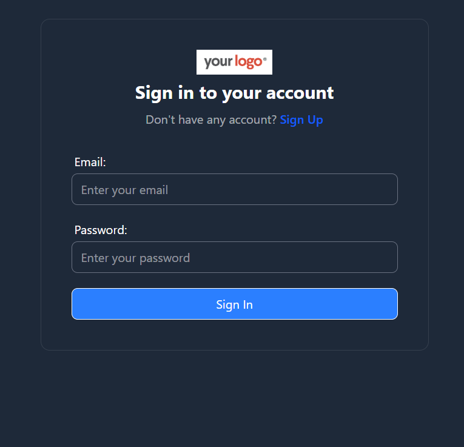
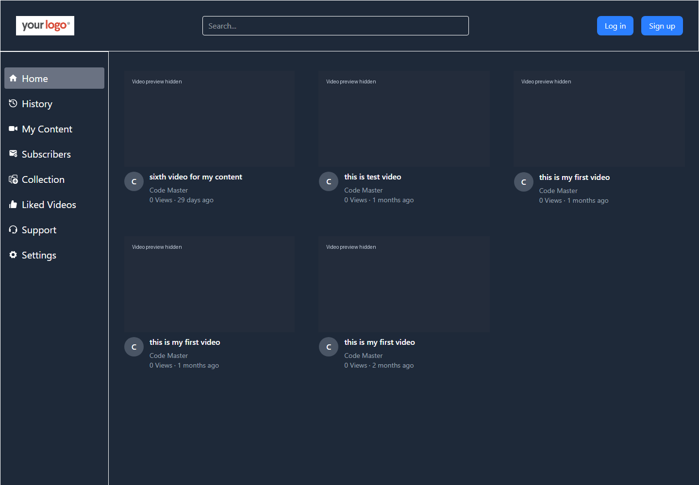
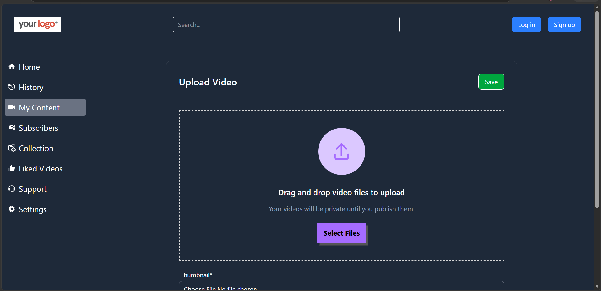

# YouTube Clone

A MERN video-sharing application with user accounts, channels, video uploads, and community features.

[Live Demo](https://youtube-clone-mern-weld.vercel.app/)

## Screenshots

### Sign in



### Home

Video previews are hidden in this capture.



### Video Upload



### Video Detail


## Features

- Register, log in, log out, and manage your profile
- Create and manage channels with avatar and cover images
- Upload videos and thumbnails, update video details, and control publishing status
- Browse videos and view video details
- Interact with videos using likes and comments
- Manage subscriptions, playlists, tweets, and watch history
- View channel and dashboard information

## Tech stack

**Frontend:** React, Vite, Redux Toolkit, React Router, Tailwind CSS  
**Backend:** Node.js, Express, MongoDB, Mongoose  
**Media storage:** Cloudinary  
**Authentication:** JSON Web Tokens

## Project structure

```text
01_Frontend/   React application
01_Backend/    Express API, MongoDB models, and media handling
```

## Prerequisites

- Node.js and npm
- A MongoDB database
- A Cloudinary account for media uploads

## Getting started

### 1. Configure the backend

```powershell
cd 01_Backend
npm install
Copy-Item .env.sample .env
```

Update `01_Backend/.env` with your own values:

| Variable | Description |
| --- | --- |
| `PORT` | Backend port (the sample uses `3000`; the server defaults to `8000`) |
| `MONGODB_URI` | MongoDB connection URI; the app appends the `mern_project` database name |
| `CORS_ORIGINS` | Comma-separated list of frontend origins allowed to call the API, e.g. `http://localhost:5173` |
| `ACCESS_TOKEN_SECRET` | Secret used to sign access tokens |
| `ACCESS_TOKEN_EXPIRY` | Access-token lifetime, e.g. `1d` |
| `REFRESH_TOKEN_SECRET` | Secret used to sign refresh tokens |
| `REFRESH_TOKEN_EXPIRY` | Refresh-token lifetime, e.g. `10d` |
| `CLOUDINARY_NAME` | Cloudinary cloud name |
| `CLOUDINARY_API_KEY` | Cloudinary API key |
| `CLOUDINARY_SECRET_KEY` | Cloudinary API secret |

Keep `.env` files and secret values private. Do not commit credentials to source control.

Start the backend:

```powershell
npm run dev
```

The API is mounted under `/api/v1` (for example, the health check route is `/api/v1/healthcheck`).

### 2. Configure and start the frontend

In a second terminal:

```powershell
cd 01_Frontend
npm install
Copy-Item .env.sample .env
npm run dev
```

Vite serves the frontend at `http://localhost:5173` by default. The frontend reads `VITE_API_URL`; the sample leaves it empty so API requests use relative `/api/...` paths.

The current Vite development proxy forwards `/api` requests to the project's hosted backend. To use your local backend instead, change the proxy target in `01_Frontend/vite.config.js` to `http://localhost:3000` (or the port configured in the backend `.env`). Make sure that port is included in `CORS_ORIGINS` as `http://localhost:5173`.

## Available scripts

Run these commands from the relevant project directory.

### Frontend (`01_Frontend`)

| Command | Description |
| --- | --- |
| `npm run dev` | Start the Vite development server |
| `npm run build` | Build the frontend for production |
| `npm run preview` | Preview the production build |
| `npm run lint` | Run ESLint |

### Backend (`01_Backend`)

| Command | Description |
| --- | --- |
| `npm run dev` | Start the backend in development mode |
| `npm start` | Start the backend |

## API areas

The backend exposes versioned routes for users, videos, subscriptions, likes, comments, playlists, tweets, dashboards, and health checks. The route prefix is `/api/v1`; for example, user routes are under `/api/v1/user` and video routes under `/api/v1/video`.

## License

No project-specific license is currently documented. Add a `LICENSE` file if you intend to publish or distribute the project under a particular license.
